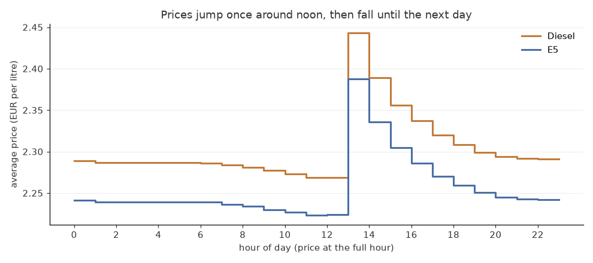
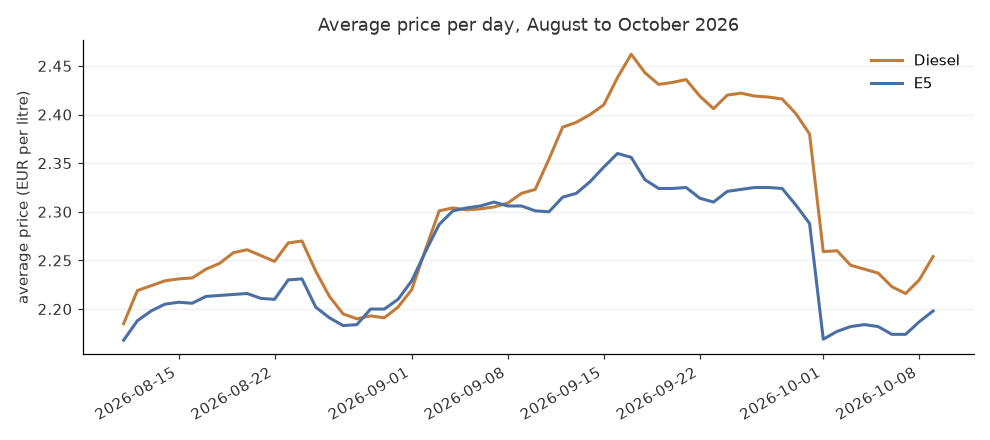
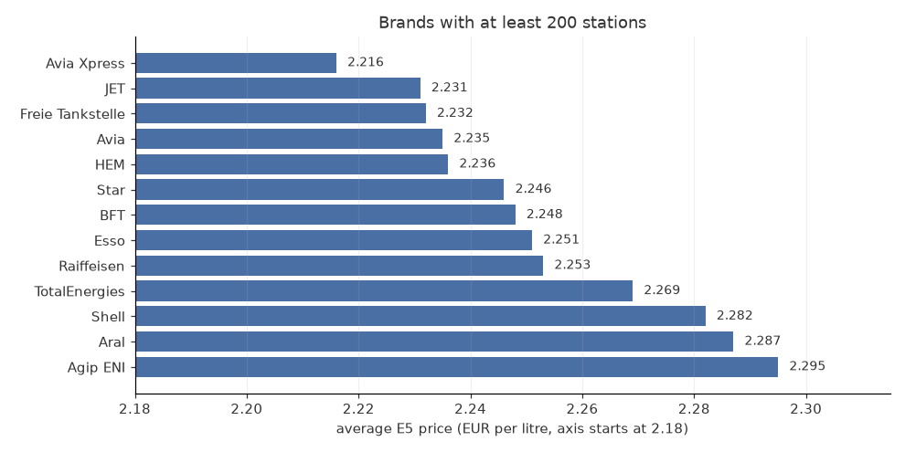

# Fuel Price Pipeline

Petrol stations in Germany have to report every price change, and
Tankerkönig makes that data open. This project collects it and turns it
into clean tables on Databricks.

It has two parts:

- **Live prices:** every hour, the current prices of all stations within
  10 km of Freiburg.
- **History:** the full daily files from Tankerkönig for all of Germany,
  with every price change and the station list for each day.

## What I found

From two months of history, 10 August to 9 October 2026: 15,092 stations
and 12.8 million price changes. An average station changes its price
14 times a day.

**Prices go up once a day, between 12 and 13 o'clock, and then come down
slowly until the next day.** At 12:00 the average E5 price is 2.22 €, at
13:00 it is 2.39 €. That is 16 cents more within one hour. Diesel jumps
by 17 cents at the same time.



So the time you fill up matters more than I expected. The cheapest time
is the late morning, just before the jump. The evening is almost as
cheap, about 2 cents more. Right after noon is the worst time to tank.
At a single station, the highest and the lowest E5 price of a day are
on average 17 cents apart.

The price also moves a lot from week to week. E5 went from 2.17 € in
August up to 2.36 € in mid September. Diesel went even higher, to 2.46 €.
On 1 October both dropped by about 12 cents in a single day.



The brand matters less than the time of day, but it is not nothing.
Among the 13 brands with at least 200 stations, Avia Xpress was the
cheapest and Agip ENI the most expensive, 8 cents apart. Aral and Shell,
the two biggest networks, are among the most expensive, about 5 cents
above JET.



One caution with the brands: this is a simple average. It does not take
into account where the stations are, and a station on the motorway is
more expensive whatever its brand.

The numbers come from `analysis/price_patterns.sql`, run on Databricks.
The results are saved as CSV files in `analysis/`, and
`python analysis/make_charts.py` draws the charts from them.

To get the price at a given hour, I could not just average the price
changes, because busy hours have more changes and would count more.
Instead every station gets one row per hour, and that row takes the
last price before it. That is about 21 million station-hours in total.

## How it works

```
Tankerkönig API / history files
          |
          |  Python jobs on Databricks
          v
  Volume: fuel.raw.landing      raw JSON and CSV, never changed
          |
          |  Auto Loader (PySpark)
          v
  fuel.raw.*                    raw tables
          |
          |  dbt
          v
  fuel.cleaned.*                clean tables
  fuel.reporting.daily_prices   one row per station per day
```

The raw replies are saved first and only read later. If a model is
wrong, I can rebuild it from the saved files without asking the API
again.

Loading uses Auto Loader with `availableNow`, so every run picks up only
the new files and then stops. Checkpoints keep track of what was already
loaded.

## The tables

| Table | What it holds |
|---|---|
| `stations` | Latest name, brand and address of each station |
| `prices` | Every hourly reading of diesel, E5 and E10 |
| `price_changes` | Every price change from the history files |
| `station_history` | Station details over time, one row per version |
| `reporting.daily_prices` | Average price per station per day |

`station_history` keeps old versions of a station. When a station changes
its name, brand or address, a new row starts with `valid_from`, and the
old row gets a `valid_to`. It is built with window functions over the
daily station lists in the history files.

A price of 0 in the history means the station has no price for that fuel,
so it becomes null.

## Tests

`dbt build` runs the models and the tests together:

- station ids are not null and unique
- every price belongs to a known station
- no station has two price changes at the same time
- every station has exactly one current version in `station_history`
- prices outside 1 to 3 euros raise a warning, not an error, because
  they can be real

The same models also run on every push in GitHub Actions, without
Databricks. `tests/test_dbt_models.py` starts a local Spark session,
fills the raw tables with a small hand-made dataset, runs `dbt build` on
it, and then checks the results. For example, that a station which
changed its brand gets two versions, and that a price at 23:30 UTC
counts for the next day in Germany.

```
pip install -r requirements-test.txt
pytest
```

You need Java for Spark.

## Jobs

Both jobs are defined in `resources/` as a Databricks Asset Bundle and
run from this repo:

- `fuel_prices`: fetch, load, dbt build. Runs every hour.
- `fuel_history`: fetch the last 7 days of history, load, dbt build.
  Runs every morning at 8.

A failed run sends an email. Both schedules are paused right now.

## Running it

You need a Databricks workspace and a free API key from
[Tankerkönig](https://creativecommons.tankerkoenig.de/).

1. Run `setup/01_catalog.sql` once to create the catalog, schemas and
   volumes.
2. Put your Tankerkönig API key and login in a Databricks secret scope
   called `fuel`.
3. Deploy the jobs:

```
databricks bundle deploy
databricks bundle run fuel_prices
```

To load an older range of history:

```
python ingestion/fetch_history.py 2026-09-01 2026-09-30
```

## Stack

Databricks (Unity Catalog, Volumes, Jobs, Asset Bundles), PySpark Auto
Loader, dbt, Python.

## Data

[Tankerkönig](https://creativecommons.tankerkoenig.de/), licence
CC BY-NC-SA 4.0.
